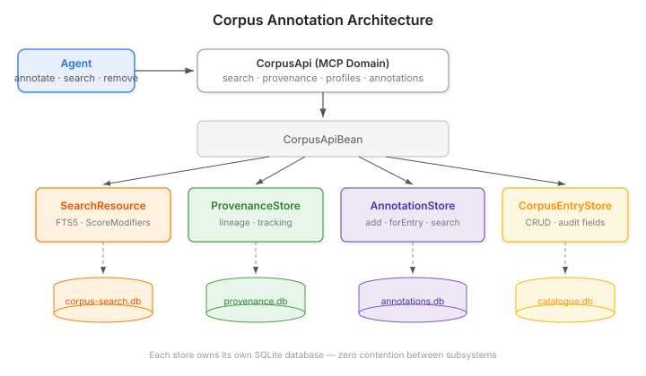

# The Corpus That Talks Back

A knowledge corpus is a collection of documents you search. That's the standard model — you put documents in, you get relevant passages out. The corpus is inert. It holds what you gave it and returns what you asked for.

But what happens when an agent retrieves an entry and discovers it's wrong?

Not wrong in a way that warrants deleting it. Wrong in a way that matters to the *next* consumer — outdated after a framework upgrade, contradicted by a finding in another entry, or flagged for revision because retrieval metrics show high access but low quality feedback. The agent knows this. The corpus doesn't.

The standard response is to fix the entry. But not everything can be fixed immediately, and not every annotation is a correction. Sometimes the note is "this gotcha no longer applies after Quarkus 3.36." Sometimes it's "contradicts finding in GE-20261015." Sometimes it's "high retrieval, low satisfaction — needs a rewrite." These are marginal notes, not replacements. Sticky notes on the page.

## Why the corpus can't hold its own metadata

You might think: just add a field to the entry. Put a `notes` array in the metadata map and let agents append to it.

Three problems.

First, the entry is an authored artifact. It has provenance — someone wrote it, at a specific time, with specific intent. Mixing agent commentary into the entry's own metadata blurs the boundary between the document and reactions to the document. A retriever searching for "Quarkus configuration gotchas" shouldn't match against an annotation saying "this Quarkus gotcha is outdated." The annotation is about the entry; it's not part of the entry.

Second, annotations have their own lifecycle. An entry might live for years. An annotation might be relevant for a week — until the entry is revised, or the version upgrade ships, or the contradicting finding is resolved. Annotations come and go faster than entries. Coupling their storage means coupling their lifecycles.

Third, search semantics. Corpus search exists to find relevant documents by content. Annotation search exists to find entries with specific commentary — "show me everything flagged as stale." These are different queries with different intent. Mixing them means either polluting document search with meta-commentary or building complicated exclusion filters.

## The annotation layer

The solution is a separate annotation store. Not a graph (the MindMap store already handles knowledge graphs, and its SQLite WAL is busy with consolidation phases, trait rules, and confidence decay). Not a memory (annotations aren't experiences — they're observations *about* artifacts).

A purpose-built store, with its own database, that answers two questions: "what do agents think about this entry?" and "which entries have annotations matching this text?"



The architecture follows a pattern the corpus-management module already established. Each subsystem — search, provenance, annotations, entry catalogue — owns its own SQLite database through `SqliteDataSourceFactory`. Separate HikariCP pools, separate WAL journals, zero cross-subsystem contention. An agent annotating entries at high frequency doesn't slow down a concurrent search operation.

The `AnnotationStore` SPI is small:

```java
public interface AnnotationStore {
    String add(CorpusAnnotation annotation);
    void remove(String annotationId);
    List<CorpusAnnotation> forEntry(String corpusId, String entryId);
    List<CorpusAnnotation> forEntry(String corpusId, String entryId, String type);
    List<CorpusAnnotation> search(String text, String type, int limit);
    int removeForEntry(String corpusId, String entryId);
}
```

No `update`. Annotations are immutable notes — if the assessment changes, delete and write a new one. This keeps the model honest. An annotation says what an agent thought at a specific time. Editing it would rewrite history.

## Typed annotations and why they matter

Every annotation carries a string type. Not an enum — a free-form string with documented constants, following the same pattern MindMap uses for subgraph types.

```java
public final class AnnotationTypes {
    public static final String QUALITY_FLAG = "quality-flag";
    public static final String CONTRADICTION = "contradiction";
    public static final String STALENESS = "staleness";
    public static final String NOTE = "note";
}
```

Types enable filtering. "Show me all staleness annotations" is a different query from "show me all annotations." A consolidation phase that wants to find entries needing revision filters on `quality-flag`. A version-upgrade audit filters on `staleness`. The type makes the annotation actionable, not just informative.

And because it's a string, domain-specific consumers can define their own types without touching the SPI. A medical corpus might add `clinical-update`. A legal corpus might add `superseded-by-statute`. The four built-in constants cover the common cases; the extension point covers everything else.

## What this changes in practice

Before annotations, corpus quality feedback was indirect. The retrieval tracking system recorded what was retrieved and how often. The provenance system recorded which entries informed which issues. Staleness detection lived in a Hortora-specific extension. None of these let an agent say something specific about a specific entry.

With annotations, the feedback loop tightens. An agent retrieves an entry, evaluates it against current context, and — if something is off — leaves a typed note. The next agent to retrieve that entry sees the annotation. The next consolidation pass can act on it. The next human reviewer has the agent's assessment in front of them before they start reading.

The entry itself doesn't change. The annotation is a separate artifact with its own author, timestamp, and type. It can be searched independently, filtered by type, and deleted when resolved. It's the difference between writing in the margin of a shared document and editing the document itself.

The corpus is no longer inert. It accumulates institutional knowledge about its own quality — one sticky note at a time.
