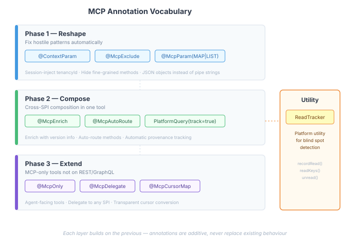
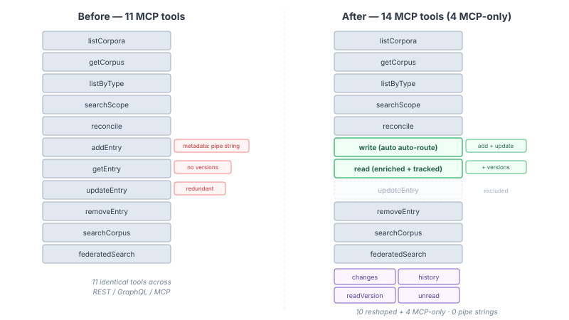
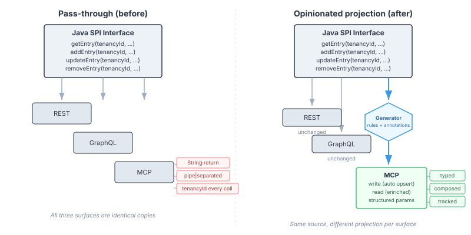

# Teaching the Generator What Agents Need

Last week I audited every `@McpDomain` across the casehub platform — thirteen domains, seventy methods, three repos — and found a systemic problem. The MCP tool surface was a direct mirror of the Java SPIs. Pipe-separated string parameters. Untyped mutation returns. `tenancyId` passed on every single call. Every pattern that makes sense in a REST API designed for developers makes an LLM agent's life harder.

The original blog — [The API the Agent Never Asked For](/blog/2026-11-07-mdp01-the-api-the-agent-never-asked-for) — diagnosed the problem. This one is about the fix. Not hand-writing a separate MCP layer, but teaching the existing generator to project differently for agents.

## The constraint that matters

We built `@McpDomain` deliberately. Annotate a Java interface once, get REST, GraphQL, and MCP from the same source. No drift between surfaces. The review's recommendation — "treat MCP as a separate design surface" — was the nuclear option. Better MCP tools, but you lose the no-drift guarantee that justified the whole approach.

The question I sat with: can the generator produce agent-optimised MCP tools from the same interface, without changing what REST and GraphQL see?

The answer turned out to be yes, and the mechanism is smaller than I expected.

## What the generator already knew

We already had `@ContextParam` — an annotation that tells the generator "this parameter is resolved server-side, not from the client." REST endpoints inject it from the HTTP auth context. GraphQL resolvers do the same. The MCP scanner skips it entirely and the dispatcher resolves it from `CurrentPrincipal`.

The infrastructure was fully built. The problem was that nobody used it. Every `@McpDomain` interface across the platform declared `tenancyId` as a plain `String` parameter, passed on every call by every surface, even though the platform already knew the tenant from the authentication context.

Adding `@ContextParam("tenancyId")` to every interface was the first fix — three repos, twelve files, sixty-six parameters. No generator changes. The mechanism already existed; the domain authors just hadn't reached for it.

That taught me something about how this should work. The generator should apply reasonable defaults automatically. Annotations are for the cases it genuinely can't infer.

## Three layers of projection

The annotation vocabulary grew in three phases, each independently useful, each building on the last.



### Phase 1: Reshape hostile patterns

Three rules, the biggest-impact changes:

**Auto-detect weak mutation returns.** When a `@PlatformMutation` method returns `String` or `void`, the MCP dispatcher wraps the result in `{success: true, id: "...", timestamp: "..."}`. REST still returns the raw string. The agent gets structured confirmation of what happened.

**`@McpExclude`** hides a method from the MCP surface. Paired add/update methods, admin operations too granular for agents, methods consumed internally by other annotations — mark them excluded, they disappear from MCP, REST and GraphQL keep them.

**`@McpParam(format = MAP)`** on a String parameter that the bean parses as pipe-separated key=value. The MCP tool schema declares a JSON object. The dispatcher serialises it back to the pipe-separated format before calling the bean. The agent sends `{"title": "My Doc", "author": "Jane"}`. The bean's `parseMetadata()` still works. Same for `@McpParam(format = LIST)` — pipe-separated lists become JSON arrays.

Here's what `addEntry` looks like with Phase 1 annotations:

```java
@PlatformMutation("Add a new entry to a corpus")
String addEntry(@ContextParam("tenancyId") String tenancyId,
                String corpusName, String entryId, String body,
                @McpParam(format = McpParamFormat.MAP) String metadata,
                String artifactRef);
```

The Java method signature is unchanged. The bean implementation is unchanged. REST sends `metadata=title%3DMy+Doc%7Cauthor%3DJane` as a query param. MCP sends `{"metadata": {"title": "My Doc", "author": "Jane"}}`. The generator does the translation.

### Phase 2: Compose across SPIs

This is where it gets interesting. An agent reading a corpus entry wants the document content, version history, and provenance tracked — all in one call. That's three SPI calls composed into one tool.

**`@McpEnrich`** calls a second SPI method after the primary and merges its result into the MCP response:

```java
@McpEnrich(spi = CorpusReader.class, method = "versions", as = "versions")
@PlatformQuery(value = "Read a document with full context", track = true)
CorpusEntry getEntry(@ContextParam("tenancyId") String tenancyId,
                     String corpusName, String entryId);
```

REST returns `CorpusEntry`. MCP returns `{...entry fields..., versions: [...]}` — the entry enriched with its version history. One call, complete result.

**`@McpAutoRoute`** merges two related methods into one auto-detecting tool:

```java
@McpAutoRoute(check = "getEntry", alternate = "updateEntry")
@PlatformMutation("Add or update a corpus entry")
String addEntry(...);

@McpExclude
@PlatformMutation("Update an existing entry")
String updateEntry(...);
```

The MCP tool calls the check method first. If the resource exists, it routes to the alternate. If not, the primary runs. The result includes `{success, id, created: true|false, timestamp}`. The agent says "put this content here" and doesn't care whether it's new. The same pattern works for any pair of methods where one handles the "exists" case and the other handles "doesn't exist."

**`PlatformQuery(track = true)`** records access via a platform `ReadTracker` utility. Every read by a specific agent is logged. This enables the blind-spot query later.

### Phase 3: MCP-only tools

Some agent workflows need tools that don't correspond to any existing SPI method. Change detection, version history browsing, blind-spot queries — these exist only in the MCP surface.

**`@McpOnly`** marks a method as MCP-only. **`@McpDelegate`** tells the dispatcher which SPI to invoke:

```java
@McpOnly("What changed since a point in time")
@McpDelegate(spi = ChangeSource.class, method = "changesSince")
default ChangeSet changes(String cursor) {
    throw new UnsupportedOperationException("MCP-only");
}
```

The REST generator ignores it — no `@PlatformQuery`, no endpoint. The MCP scanner picks it up, the dispatcher resolves `ChangeSource` from the application context and invokes `changesSince()`. The agent gets a tool that didn't exist before, without any new implementation code.

## The corpus before and after



The `CorpusManagementApi` started with eleven methods projected identically to REST, GraphQL, and MCP. Pipe-separated metadata. String returns. No version info. No change detection. No way to ask "what haven't I read?"

After annotation:

- `addEntry` + `updateEntry` → one `write` tool with auto-routing and structured metadata
- `getEntry` → enriched with version history, access tracked for provenance
- `removeEntry` → typed result instead of bare string
- Four new MCP-only tools: `changes`, `history`, `readVersion`, `listEntries`
- `unread` — cross-references the entry list against the agent's read history

The REST and GraphQL surfaces didn't change at all. Same endpoints, same types, same behaviour. The MCP surface went from a hostile mirror of REST to something designed for how agents actually work.

## The generator's job



The shift in thinking: `@McpDomain` is not a pass-through. It's an opinionated projection layer. The generator already knew how to project differently per surface — REST turns `@PathParam` into URL segments, GraphQL turns `@PlatformStream` into subscriptions. The MCP projection just needed its own opinions:

- Mutations that return nothing useful get a structured result
- Parameters that are really structured data get projected as JSON
- Operations that agents don't need get hidden
- Read operations can be enriched with data from other SPIs
- Tools can exist that only make sense for agents

The annotation vocabulary is small — eight annotations, one attribute, one utility:

| Annotation | What it does |
|-----------|-------------|
| `@ContextParam` | Session-inject from CurrentPrincipal |
| `@McpExclude` | Hide from MCP |
| `@McpParam(MAP\|LIST)` | JSON object/array with automatic serialisation |
| `@McpEnrich` | Compose with second SPI, merge result |
| `@McpAutoRoute` | Auto-detecting method routing |
| `@McpOnly` | MCP-only tool |
| `@McpDelegate` | Route to specified SPI |
| `@McpCursorMap` | Transparent timestamp conversion |
| `PlatformQuery(track=true)` | Record access for blind-spot detection |
| `ReadTracker` | Platform utility for read/unread queries |

Each one preserves the single-source guarantee. The Java interface is annotated once. Three surfaces are generated. Each surface gets the projection that serves its consumers.

## What this means for new domains

Every future `@McpDomain` across the platform benefits from the generator rules without touching domain code. String/void mutation returns are auto-wrapped. That's the baseline.

Domain authors who want better MCP tools add annotations to their existing interface. `@McpParam(MAP)` on a pipe-separated parameter. `@McpEnrich` when a read should include data from another SPI. `@McpOnly` when agents need a tool that REST doesn't.

The tools the agent sees are designed for the agent. The SPIs the developer implements are designed for the developer. The generator bridges them, and neither side has to compromise.
