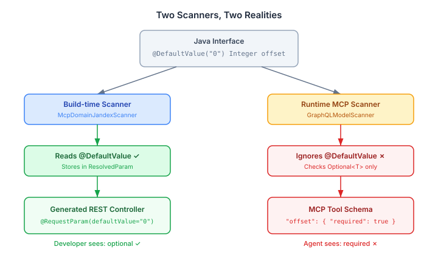

# The Annotation the Agent Never Saw

I shipped a change yesterday that compiled, passed every test, and did absolutely nothing for the agent it was supposed to help. The annotation was real. The code was correct. The MCP tool schema was identical before and after. The agent never saw the difference.

This is a post about how that happened and what it taught me about verifying agent-facing changes.

## The task

Engine issue #1320: two small improvements to the MCP surface. Make `listDefinitions` work without pagination parameters — agents calling "show me the case definitions" shouldn't have to know about offset and limit. And improve `GalleryMcpAdapter` so agents can look up gallery projections more easily.

Small scope. Clear requirements. I wrote the code, it compiled, the tests passed. Then I asked myself what I should have asked first: what does the agent actually see?

## Two scanners, one annotation

The platform has a `@DefaultValue` annotation. It lives in `io.casehub.platform.api.mcp`. It does what you'd expect — declares a default value for a parameter. I added `@DefaultValue("0")` to the `offset` parameter on `listDefinitions`. The service already handled null offset by defaulting to zero. The annotation would tell the schema generator to mark it optional. Clean, minimal change.

Except it didn't.



The platform has two completely separate scan paths. The build-time scanner (`McpDomainJandexScanner`) reads `@DefaultValue`, stores it in a `ResolvedParam` record, and emits `@RequestParam(defaultValue="0")` in the generated REST controller. REST clients get the optional parameter they expect.

The runtime MCP scanner (`GraphQLModelScanner`) doesn't read `@DefaultValue` at all. It determines `required` with one line:

```java
boolean required = !Optional.class.isAssignableFrom(param.getType());
```

`Integer` is not `Optional`. So `required = true`. The agent sees `offset` as mandatory, same as before. The annotation is invisible.

## The second mistake was worse

For `GalleryMcpAdapter`, the issue asked for a composite key parameter — let agents pass `definitionKey` as `"namespace/name/version"` instead of three separate params. I added `definitionKey` alongside the existing `namespace`, `name`, `version` parameters, with logic to parse it if provided and fall back to the individual params otherwise.

The intent was "pass either the composite key or the three parts." The reality was that the MCP scanner marked all four parameters as `required: true`. The agent went from seeing three mandatory params to four. No "or" semantics. No optional fallback. Strictly worse.

And here's the part that matters: `CaseDefinitionView` — what agents get back from `listDefinitions` — already returns `namespace`, `name`, and `version` as separate fields. The agent already has the three parts. A composite key format it has to construct by concatenating fields it already has is not reducing friction. It's adding a step.

## What actually works

The fix for `listDefinitions` was to change the Java type:

```java
CaseDefinitionPage listDefinitions(
    @ContextParam("tenancyId") String tenancyId,
    Optional<Integer> offset,
    Optional<Integer> limit);
```

`Optional<Integer>` passes the scanner's one-line check. The agent sees offset and limit as not-required. The implementation unwraps with `orElse(null)` — the service already defaults null to 0 and 20 respectively. The generated REST controller correctly propagates `Optional<Integer>` through JAX-RS, which handles absent query params natively.

For `GalleryMcpAdapter`, the fix was to revert the `definitionKey` parameter entirely and improve the descriptions instead:

```java
@PlatformQuery("Get agent descriptors for all workers in a case definition. "
    + "Use namespace, name, version from listDefinitions results.")
```

Three required params, same as before. But now the description tells the agent where to get the values. That's the intervention that actually helps — not fewer params, but a description that connects one tool's output to another tool's input.

## The quality gate this demands

The pattern here generalises beyond one annotation. Any annotation-driven framework with multiple consumers — REST, GraphQL, MCP, each with its own scanner — can have this failure mode. An annotation that affects one surface can be invisible to another. The code compiles. The tests pass. The change ships. The target consumer never sees it.

I've added a quality gate to the MCP remediation project. Two passes — one before implementation, one after.

Before writing code: trace the agent's actual workflow. Where does it get each parameter value? What did the previous tool call return? Read the scanner code that processes the annotation. Don't assume it works the way it sounds.

After the code compiles: verify mechanically that the MCP schema changed the way you intended. Re-trace the agent workflow with the new surface. If the schema didn't change, you didn't ship an agent improvement — you shipped an annotation.

The uncomfortable realisation is that this applies retroactively. Every `@DefaultValue` annotation across the platform has this same failure mode — visible to REST, invisible to MCP. Every parameter that should be optional for agents but uses `@DefaultValue` instead of `Optional<T>` is silently required in the tool schema. That's worth auditing.

## The broader point

Building MCP tools for agent consumption requires a different verification discipline from building REST APIs. For REST, compilation and tests are sufficient — the consumer is a developer who reads documentation and constructs requests deliberately. For MCP, the consumer is an LLM that reads the tool schema. If the schema doesn't change, the agent's experience doesn't change, regardless of what annotations you added.

The annotation I shipped yesterday was correct in every sense that a Java developer would check. It compiled. It was well-typed. It had a clear intent. The build-time scanner read it and produced the right REST controller. But the runtime scanner — the one that builds the tool schema the agent reads — never looked at it.

The change that actually worked was a type change: `Integer` to `Optional<Integer>`. One word in the type signature, zero annotations, and the agent's experience changed immediately. Sometimes the most effective API improvement is the one that speaks the right scanner's language.
