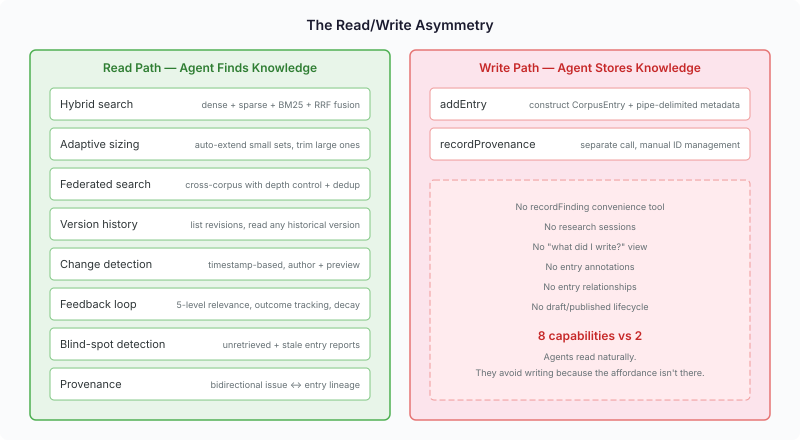
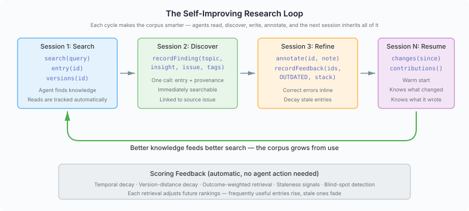

# The Library That Learns — Building a Corpus LLMs Actually Want to Use

A month ago I audited our corpus management module and found it was a Hortora skin over what should have been generic infrastructure. Two weeks ago I rewired the API so agents interact with structured knowledge instead of byte arrays and cursor strings. Today I'm looking at the result and asking the harder question: have we built something LLMs will actually reach for?

The answer is yes — with a caveat that exposes a pattern I think every LLM platform will hit.

## What the read side looks like now

The corpus library's read path is genuinely excellent. Not "works in a demo" excellent — production-quality with real depth:

**Hybrid search** combines dense embeddings, sparse SPLADE vectors, and BM25 keyword matching through reciprocal rank fusion. An agent searching for "thread safety in ONNX Runtime" gets semantically relevant results even when the entry uses different terminology, but also exact-match results when the keywords appear verbatim. Three retrieval strategies, fused automatically.

**Adaptive sizing** solves the "how many results?" problem. The agent asks for 16 results, but the system overfetches by 2-3x, then applies gap detection and floor filtering. If there are only 4 genuinely relevant results, it returns 4 — not 12 results padded with noise. If there are 20 strong results, it extends past the requested limit rather than dropping good matches. The agent never has to tune result counts.

**Federation** chains searches across corpus hierarchies. A team's domain corpus federates upstream to the platform knowledge base. Search flows across the chain with depth control, deduplication, and per-corpus weighting. An agent searching its project corpus seamlessly gets platform-level knowledge when local results are thin.

**Version history** — closed this session — lets agents see a document's revision timeline and read any historical version as structured content. For git-backed corpora, each version carries the commit SHA and author. An agent reviewing a changed document can compare current and previous versions to understand what shifted.

**Change detection** answers "what's new since yesterday?" with one timestamp-based call. The agent gets structured records with authors, change types, and content previews. No cursor management, no polling, no opaque state.

**The feedback loop** is where it gets interesting. Five-level retrieval feedback (from HIGHLY_RELEVANT through OUTDATED) feeds directly into scoring. Temporal decay reduces stale entries. Version-distance decay reduces entries verified against outdated dependency versions. Outcome recording tracks whether entries led to successful work. The `unretrieved` tool surfaces blind spots — entries no agent has ever read.

This isn't decorative. Each retrieval adjusts future rankings. Frequently useful entries rise. Stale entries fade. Entries marked OUTDATED with a specific stack context get downranked for that stack but stay available for others. The corpus gets smarter as agents use it.

## The asymmetry nobody designed

But when I assessed the write side against the same standard, the gap was uncomfortable.



The read path has eight distinct capabilities, each with agent-ergonomic affordances. The write path had two: `addEntry` (construct a `CorpusEntry` with pipe-delimited metadata strings, manage your own ID) and `recordProvenance` (separate call, manual ID wiring). Two storage primitives dressed up as MCP tools.

The practical consequence: agents search the corpus naturally but avoid writing to it. The friction isn't conceptual — an agent knows it should store a finding for later sessions. The friction is mechanical. To store one finding, the agent has to:

1. Generate an entry ID
2. Format metadata as pipe-delimited key-value pairs
3. Construct a `CorpusEntry` record
4. Call `addEntry`
5. Parse the entry ID from the response
6. Call `recordProvenance` with the entry ID and source issue
7. Hope it remembered the exact format for each parameter

Compare that to reading: `search("thread safety ONNX")`. One call. Natural language. Results with content.

This asymmetry isn't accidental — it's a pattern. The read side was designed through iterative agent testing. Real agents searched, we saw what frustrated them, we fixed it. Adaptive sizing came from watching agents request 50 results and then only use 3. Change detection came from watching agents re-read entire corpora each session. Version history came from watching agents make follow-up `getEntry` calls just to check timestamps.

The write side was designed from Java API conventions. `CorpusEntryStore.add()` takes a `CorpusEntry` because that's what a Java storage SPI does. Nobody watched an agent struggle to construct one.

## Closing the first gap: recordFinding

The fix is a convenience tool that matches how agents think about writing:

```java
@PlatformMutation("Record a research finding — stores as a corpus entry "
    + "with metadata and provenance in one call.")
String recordFinding(String corpusId, String topic, String insight,
    String sourceIssue, String tags, String domain, String type);
```

An agent writes:

```
recordFinding(topic: "ONNX thread safety",
              insight: "OrtSession is thread-safe but OrtEnvironment must be singleton",
              sourceIssue: "casehubio/neocortex#856",
              tags: "java|onnx", domain: "jvm", type: "finding")
```

One call. The tool generates a `GE-YYYYMMDD-hexhex` entry ID, structures the metadata, persists the entry, indexes it for search, and records provenance linking it to the source issue — all automatically. The agent gets back the entry ID for reference. The finding is immediately searchable by any future session.

This is the pattern the read side already follows. `search()` doesn't expose `RetrievalQuery` construction, `PayloadFilter` building, or `CaseRetriever` orchestration. It takes a natural-language query and handles the machinery. `recordFinding` does the same for writes.

## What's still missing

Closing the `recordFinding` gap revealed the deeper ones. The read side doesn't just have search — it has a complete research workflow (profiles, adaptive sizing, federation, feedback, blind-spot detection). The write side needs equivalent depth:

**Research sessions.** An agent doing multi-session research can't persist its investigation state. `ResearchSessionService` exists as an SPI — create, pause, resume, complete — with MindMap subgraph linking. But it's not wired through MCP. Each session starts cold. The next agent can search for findings but can't ask "where did the last session leave off?" or "what questions are still open?"

**Agent contributions view.** The read tracker knows what each agent has read. There's no write counterpart. An agent can't ask "what did I write last session?" — a basic requirement for session handover. Without this, the resuming agent has to search for its own previous work by guessing keywords.

**Entry annotations.** An agent that spots an error in an entry can mark it OUTDATED, but can't explain why. A future session sees the score penalty but not the reasoning. Inline annotations — "this is wrong because the API changed in Quarkus 3.32" — would give future sessions the context to act, not just the signal to distrust.

**Entry relationships.** Findings relate to each other: one supersedes another, contradicts another, updates another with new information. The `see_also` mechanism exists for expanding search results, but agents can't create or query relationships. When a new finding supersedes an old one, the old entry should naturally fade — but today there's no way to express that connection.

**Entry lifecycle.** Entries are present or deleted. No draft state for provisional findings during exploratory research. No archived state for superseded entries that should be preserved but not actively surfaced. An agent drafting notes during investigation can't distinguish "I'm pretty sure about this" from "this is tentative — verify before relying on it."

These aren't nice-to-haves. They're the write-side equivalents of capabilities the read side already has. Feedback loop ↔ annotations. Blind-spot detection ↔ contributions view. Adaptive search ↔ research sessions. Version history ↔ entry lifecycle.

## The research loop

What emerges when both sides are complete is a self-improving research loop:



Session 1 searches and reads. Session 2 discovers something and writes it back with `recordFinding`. Session 3 reviews, annotates errors, marks stale entries. Session N resumes with `changes(since)` and `contributions()` — a warm start that knows what changed and what it wrote.

Underneath, the scoring feedback runs continuously without agent action. Temporal decay fades old entries. Outcome-weighted retrieval promotes entries that led to successful work. The corpus grows from use and improves from feedback. No human curation required — the agents curate it by using it.

This is what makes it genuinely useful for cross-session research, not just cross-session storage. Storage is "I put something here, maybe I'll find it later." Research is "I systematically built knowledge, tracked what I covered, marked what's wrong, and the next session picks up where I left off with better knowledge than I started with."

## The design principle

Every capability on the write side should be as natural as its read-side counterpart. If an agent can find knowledge in one call, it should be able to store knowledge in one call. If the system tracks what the agent reads, it should track what the agent writes. If search results carry freshness signals, entries should carry confidence signals.

The metric isn't feature count. It's whether an agent, given the choice between storing a finding in the corpus or letting it evaporate at session end, will choose to store it. Today, with `recordFinding`, the answer shifted from "probably not" to "probably yes." When research sessions, annotations, and relationships land, it should be "obviously yes."

The corpus doesn't just serve agents — it grows from their work. That's the library that learns.
