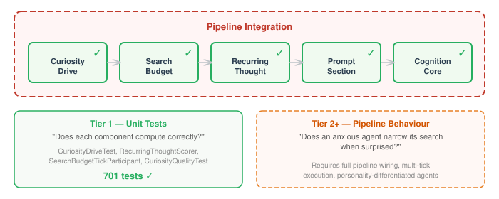
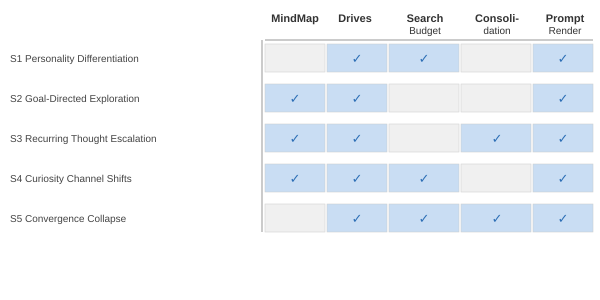

# You Can't Unit-Test Emergence

*Continues from [Curiosity That Knows Where It's Going](2026-11-08-mdp02-curiosity-that-knows-where-its-going.md).*

Every component in the cognitive exploration pipeline has tests. CuriosityDrive computes gap intensity correctly. SearchBudgetTickParticipant maps drive intensity to four budget dimensions through a sigmoid. RecurringThoughtScorer classifies topics along the HEALTHY→FIXATION→OBSESSION→RUMINATION continuum. Each prompt section renders the right prose for its input state.

All green. All passing. 701 tests in the cognition module alone.

And none of that tells me whether an anxious agent actually narrows its search when surprised.

## The gap between components and cognition

The cognitive pipeline isn't a sequence of function calls. It's a loop where personality shapes how curiosity evaluates gaps, curiosity shapes the search budget, the search budget shapes what the agent explores, and what the agent explores feeds back into curiosity. Recurring thoughts compound across ticks — a topic that keeps appearing escalates through the continuum, eventually collapsing the search budget entirely. Goals reshape which gaps matter, which redirects curiosity toward what the agent is trying to achieve rather than what merely looks interesting.

None of these properties are testable at the component level. You can verify that `InformationGapDetector.detectGaps()` returns correctly scored gaps given a graph. You cannot verify that two agents with different personalities, looking at the same graph, produce meaningfully different exploration strategies. That requires wiring the full pipeline, feeding it stimuli, and observing the output.

We already have LLM-judged quality evaluation for the *core* cognitive pipeline. `CognitiveInfluenceEvalTest` seeds characters with biographies, renders cognitive state into prompts, generates responses via the LLM, and has a judge score whether the cognitive state actually influenced behaviour. Four scenarios, all scoring 5/5: scheming drives produce manipulation, trust norms produce naive openness, beliefs shape dialogue, constraints produce avoidance. That pattern works.

But none of those four scenarios test anything from the exploration pipeline. Curiosity, search budgets, recurring thoughts, pathological convergence collapse — zero LLM-judged quality coverage. The exploration subsystem might render beautiful prose or "Convergence: 0.24" and we wouldn't know from the test suite.



## What "empirical" means here — and what it doesn't

These are not integration tests in the usual sense — "wire up the real database and check the query returns rows." They are scenario-based pipeline verifications: construct a specific cognitive profile, feed a specific sequence of observations through multiple ticks of the cognitive pipeline, and assert on structural properties of the output — budget values, gap ordering, continuum positions, channel focus types.

That's a real step up from component-level testing. The five scenarios prove that the wiring works: personality configuration reaches the search budget, goal proximity reshapes gap ranking, recurring thoughts escalate through the continuum, channel modulation follows landscape structure, and pathological thresholds collapse convergence. A broken link in any chain would fail these tests.

But the scenarios don't evaluate the *quality* of what the pipeline renders. The assertions check that convergence is 0.24 for one agent and 0.0 for another. They don't check whether the prompt prose that wraps those numbers reads as genuine cognitive experience or as mechanical reporting. The pipeline could render "Convergence: 0.24" and pass every assertion.

There's an instructive failure here. `CognitiveEvalTest` runs the pipeline at seven progressive configuration levels — baseline through full — capturing rendered prompt deltas between ticks. In theory, adding subsystems should produce progressively richer output. In practice, it runs with empty stores. No MindMap data, no memories, no experiences. Every cognitive subsystem has nothing to work with. The result: level 6 (full config) produces identical output to level 1 (mood only) — just "You're feeling emotionally even." A pipeline evaluation that doesn't feed the pipeline is verifying the absence of segfaults, not the presence of cognition.

This is the gap the pre-era emergence research identified for mood: MoodPromptSection was structurally present but behaviourally invisible because it rendered PAD numbers instead of emotional language. "A section existing and a section influencing behavior are different claims." The exploration scenarios verify the section exists. Whether it influences behaviour requires the next testing tier.

## Five scenarios, five emergent properties

Each scenario targets a property that only manifests when multiple subsystems interact.



**Personality differentiation.** Two agents, identical graph, identical observation. One has search budget parameters that make convergence easy and breadth hard (the anxious profile). The other resists convergence and explores broadly (the steady profile). Same input — different cognitive output. This is the foundational claim of the whole pipeline: personality should produce meaningfully different behaviour, not just different numbers in an internal data structure.

**Goal-directed exploration.** An agent with an active research goal in its knowledge graph. Seven topic nodes, some near the goal, some far. The test verifies that BFS proximity scoring reshapes gap ranking — distance-1 gaps score `goalRelevance = 1.0`, distance-2 score `0.7`, unrelated score `0.0`. The gap that tops the list should be goal-relevant, not merely information-theoretically interesting. Curiosity without direction is browsing. Curiosity toward a goal is research.

**Recurring thought escalation.** A single topic receives negative-valence observations over multiple ticks. The consolidation pipeline scores it via a seven-symptom composite, and the continuum position escalates from FIXATION to OBSESSION. The prompt output shifts from normal curiosity to intrusive, compulsive language. This isn't a unit test of the scorer — it's a test of the full loop: memories accumulate → consolidation runs → artifacts flow to the tick pipeline → prompt sections modulate their output. A broken link anywhere in that chain means the escalation never happens.

**Curiosity channel shifts.** An agent starts in a landscape with many small, evenly-distributed knowledge gaps — diversive curiosity territory. The landscape changes to a single deep gap with high connectivity. Curiosity channels should shift from DIVERSIVE to SPECIFIC, and the search budget should shift from high breadth to high depth. The classifier uses normalised Shannon entropy over the gap distribution; the budget uses channel modulation rules. Neither component knows about the other. The emergent property is that landscape structure drives exploration strategy.

**Convergence collapse.** When habituation failure coincides with high arousal past a pathological threshold, search budget convergence drops to zero. The agent can no longer converge on a topic — it enters a perseverative state where every direction looks equally relevant. This is the pathological end of the spectrum: not a feature to aim for, but a boundary condition that the pipeline needs to handle correctly. If convergence silently stays positive when it should be zero, the agent appears functional but is cognitively stuck.

## Why a harness, not just test methods

The first version of this was five independent test methods, each wiring `MoodOrchestrator`, `DriveOrchestrator`, `CuriosityDrive`, `SearchBudgetTickParticipant`, `CognitionCore`, and various stores from scratch. That's roughly 40 lines of construction per scenario, and every line is duplicated.

Worse, it's fragile. `CognitionCore` has an 18-parameter constructor. When a parameter changes — and it does, because this pipeline is still evolving — every test that manually constructs it breaks independently. The same problem exists for `SearchBudgetTickParticipant` (7 parameters), `DriveOrchestrator` (7 parameters), and `CuriosityDrive` (4 parameters). Multiply by the number of tests that need them, and you get a maintenance burden that discourages writing new scenarios.

The harness consolidates all of that wiring behind a builder:

```java
var harness = CognitionTestHarness.builder()
    .withMindMapStore(store)
    .agentFromDefaults("anxious",
        CognitiveDefaults.empty("anxious")
            .withSearchBudgetConfig(anxiousConfig))
    .agentFromDefaults("steady",
        CognitiveDefaults.empty("steady")
            .withSearchBudgetConfig(steadyConfig))
    .build();
```

The builder wires in-memory stores, creates stub drives for the three non-curiosity axes, constructs a real `MoodOrchestrator` and `DriveOrchestrator`, builds `CognitionCore` with all the right nulls and defaults, and registers per-agent configurations in a `CognitiveDefaultsRegistry`. Every scenario gets a fully wired cognitive pipeline in four lines.

The convenience layer is thin but matters. `harness.tick()` calls `CognitionCore.tick()` with the right `AgentDescriptor` and a no-op `SubjectResolver`. `harness.tickAndConsolidate()` runs configured consolidation phases first, pushes artifacts through the `ConsolidationMediator`, then ticks. `harness.searchBudget()` returns the computed four-dimensional budget for assertions. `harness.renderPrompt()` joins all prompt sections into the text the agent would see.

Dual-mode execution matters for different scenarios. S3 needs the full consolidation pipeline — `RecurringThoughtPhase` runs, scores topics, produces artifacts, and the next tick drains them. S5 only needs to inject a continuum position and verify the budget computation — no consolidation required. The harness supports both: `tickAndConsolidate()` for the full path, `setContinuumPosition()` + `tick()` for the injection path.

## The harness that proved itself backward

A harness built for new scenarios is one thing. A harness that retroactively simplifies existing tests is a stronger claim — it means the abstraction found the right seam.

Three test classes predated the harness. Each had its own manual wiring: `SearchBudgetPathologicalThresholdTest` mocked `DriveOrchestrator`, `AppraisalTickParticipant`, and `CognitiveDefaultsRegistry` by hand. `ContinuumRenderingTest` constructed `CuriosityPromptSection` and `SearchBudgetPromptSection` directly, threading mocked dependencies through their constructors. `RecurringThoughtIntegrationTest` built its own stores, scorer, and prompt sections from scratch.

All three migrated to the harness. The pathological threshold tests went from mocking five objects to a builder call:

```java
var harness = CognitionTestHarness.builder()
    .agentFromDefaults(AGENT, CognitiveDefaults.empty(AGENT)
        .withSearchBudgetConfig(SearchBudgetConfig.defaults())
        .withHabituationConfig(HabituationConfig.defaults()))
    .withHabituationState(AGENT, habituation)
    .withAppraisalResult(AGENT, appraisalResult)
    .build();
```

That `withAppraisalResult()` method didn't exist before the migration demanded it. The test needed to inject a specific emotional arousal score alongside a habituation failure state — the combination that triggers pathological convergence collapse. In the old test, that meant constructing a `CognitiveEmotion` with a `PadProjection`, wrapping it in an `AppraisalResult`, mocking `currentResult()` and `currentHabituation()` separately, and passing the mock to a manually-wired `SearchBudgetTickParticipant`. In the harness version, the same cognitive state is injected through two builder methods. The arousal is still a `CognitiveEmotion` — you can't simplify the domain concept — but the plumbing disappears.

The migration was a net negative in lines of code. It also revealed something about which tests belong in the harness and which don't. `CuriosityDriveTest` and `CuriosityQualityTest` stayed as unit tests — they test `InformationGapDetector` and `CuriosityDrive.evaluate()` directly, verifying that entropy peaks at partial knowledge and that BFS proximity scoring works correctly. The harness abstracts those components behind `tick()`, which means migrating would test more pipeline than intended. The right boundary: harness tests verify pipeline integration; unit tests verify component computation. Both are necessary. Neither replaces the other.

## The three tiers above

The five scenarios are Tier 2 in a five-tier testing strategy. They prove the plumbing works — the right numbers reach the right components in the right order. Three tiers remain above them, each answering a harder question.

The five scenarios are Tier 2 in a five-tier testing strategy. They prove the plumbing works — the right numbers reach the right components in the right order. Three tiers remain above them, each answering a harder question.

**Tier 3 — Emergence verification.** Does the exploration pipeline produce output that wouldn't exist without it? The proving-emergence research (September 2026) established the methodology: paired state probes with a control group. Run A with exploration disabled, Run B with full exploration, same agent, same stimuli. An LLM judge scores the behavioural delta. The dual assertion — cognitive delta ≥3 AND exceeds control — is what separates signal from LLM non-determinism. Without this, the exploration subsystem might be structurally present and behaviourally dead.

**Tier 4 — Phenomenological quality.** Does the rendered exploration description read as genuine cognitive experience? The Barrett 4-channel model (somatic, attentional, temporal, action tendency) was adapted in Era 4 into four evaluation dimensions: Register (phenomenological vs mechanical), Uncertainty (genuine ambivalence vs false confidence), Channel Coverage (channels rendered as experience vs labelled), and Thinking/Dialogue Separation. For exploration output, the channels change — Litman hedonic, Silvia comprehension, Berlyne focus, Loewenstein gap proximity replace Barrett's embodied channels — but the evaluation principle holds: are the channels *rendered* or *labelled*? "Your attention keeps circling back" is rendered. "Focus type: SPECIFIC" is labelled.

**Tier 5 — Personality differentiation (qualitative).** S1 proves two agents get different convergence values. It does not prove the *prose* describing those values reads differently. Blind judging: give an LLM two exploration descriptions and two personality profiles, ask it to match them. If it can't, the differentiation is cosmetic — different numbers plugged into the same template.

## What the scenarios actually prove

The scenarios prove the exploration pipeline's machinery works. Personality configuration reaches the search budget sigmoid. Goal proximity reshapes gap ranking via BFS. Repeated observations escalate through the clinical continuum via the consolidation artifact flow. Channel classification responds to knowledge landscape structure. Pathological thresholds collapse convergence to zero.

These are real claims, and they fail if the wiring breaks. But they're claims about plumbing, not about cognition. The pipeline computes the right state. Whether it *renders* that state in a way that shapes agent behaviour — that's the question the next three tiers exist to answer.

The five scenarios are the foundation, not the finish line. All five layers of the exploration model are now complete — personality at extreme intensity reshapes how agents explore under pressure, and intelligence capacity ceilings give each agent a distinct cognitive horizon. The model has stabilised. The `CognitiveInfluenceEvalTest` pattern — seed, render, generate, judge — is ready to extend to curiosity channels, search budget differentiation, recurring thought escalation, and pathological convergence collapse. The question is no longer whether the pipeline computes the right state. It's whether an LLM, reading the rendered description of that state, actually explores differently.
