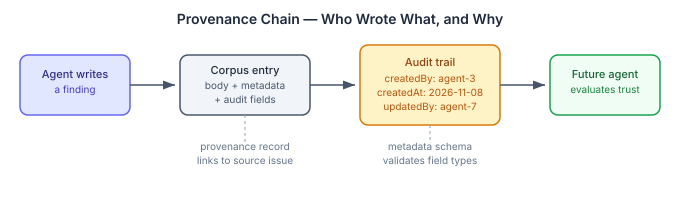
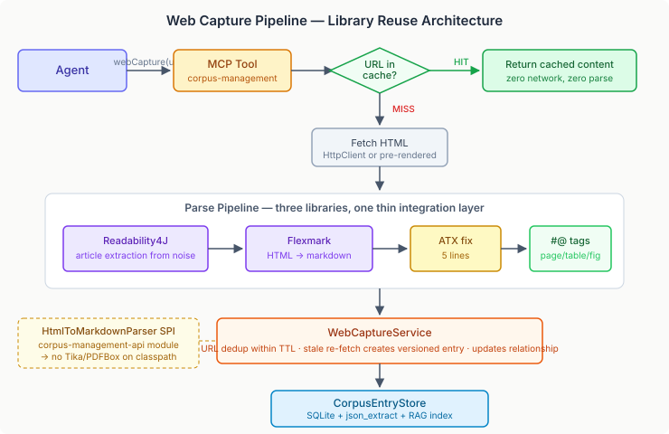

# The Corpus That Grows Itself

The write surface is complete. Annotations landed, relationships landed, and the corpus now tracks who wrote every entry and when they last touched it. That last piece — audit fields — sounds like housekeeping, but it changes something fundamental about how a multi-agent corpus works.

## Who wrote this, and should I trust it?

In a single-agent system, provenance is trivial. One agent writes, one agent reads. But the moment multiple agents share a corpus, every entry carries an implicit question: who wrote this?

An entry deposited during a deep research session, reviewed and annotated by two subsequent agents, carries different weight than one written as a quick observation that nothing ever corroborated. Without audit fields, those two entries look identical. The corpus stores the knowledge but not the chain of custody.

The fix is structural. Every `add()` and `update()` call now accepts an actor identity. The store records who created the entry, when, who last modified it, and when. This flows through to the entry response — when an agent retrieves a finding, the audit trail is right there in the metadata.

This matters for a specific practical reason: trust calibration. An agent deciding whether to rely on a corpus entry can now weigh the source. An entry written by a research agent and subsequently updated by a domain expert carries more authority than an unattributed entry with no modification history. The audit trail doesn't make the decision — the agent does — but it provides the evidence to decide on.

## The metadata problem

Audit fields exposed a deeper issue. The corpus stores metadata as an untyped `Map<String, Object>` — a bag of key-value pairs with no schema enforcement. That works when one type of document goes in. It fails when the corpus holds research papers alongside web captures alongside technical specs.

An academic paper needs `authors` (a list), `published_date` (a date), `journal`, `doi`. A web capture needs `url`, `fetched_at`, `http_status`, `content_type`. A technical spec needs `version`, `stakeholders`. These are all "metadata" but they have nothing in common beyond a few shared fields like `title` and `tags`.

The consequence is practical: you can't reliably filter search results by metadata fields when those fields might be a string in one entry and a list in another, or named `author` in one and `authors` in the next. Schema enforcement at write time is the only way to make metadata queryable at read time. Different document types register different schemas. Shared base fields are inherited. Validation catches mismatches before they pollute the index.

This isn't a hypothetical problem. The moment the corpus starts ingesting web captures at scale — different content types, different metadata shapes, different quality levels — untyped metadata becomes unsearchable metadata. The schema system has to be in place before that happens.

## The corpus that captures everything

The deeper question is where the corpus entries come from. So far, every entry has been explicitly written — an agent calls `recordFinding` or `storeFinding` with deliberate intent. The corpus grows because someone decided to put something in it.

What if it grew from the agents' natural behaviour instead?

Every research session involves web searches. An agent fetches a paper, reads a documentation page, follows a reference link. That knowledge informs the session's work and then evaporates. The next agent investigating the same topic re-fetches the same pages, re-processes the same content, re-discovers the same things.

The web knowledge cache inverts this. Every web page an agent visits becomes a corpus entry automatically. The fetch goes through a `webCapture` tool that checks the corpus first — if someone already fetched this page and it's still fresh, return the cached version. No network, no re-processing. If it's a cache miss, Playwright renders the page in a headless browser (real browser, not a bot that gets blocked), the HTML parser extracts clean article content via Readability.js, and the result goes into the corpus as a searchable entry.

Three representations are stored for each capture. A PDF snapshot preserves exactly what the page looked like — visual fidelity for future reference. A reader-view extraction preserves the semantic structure. And a positional markdown version goes into the RAG pipeline for search and retrieval. Different representations serve different needs. The markdown is for finding; the PDF is for verifying.

## Access patterns as curation

The interesting design decision is curation. A static corpus is curated by humans — someone reviews entries before they go in. An agent-fed corpus uses lifecycle states as a quality mechanism. But a web cache that captures every page an agent visits will accumulate noise fast. Most fetched pages are glanced at once and never consulted again.

The answer is TTL-based curation with access-renewal. Every cached entry has a time-to-live — thirty days by default. The retrieval tracker, which already records every agent's access to every document, serves as the curation signal. If any agent retrieves the entry within its TTL, the clock resets. Useful content stays alive because agents keep finding it useful. Content that nothing ever retrieves again ages out silently.

This works specifically because the platform is multi-agent. A page that five independent agents in separate sessions all find useful is clearly worth keeping. The access pattern across agents is a stronger quality signal than any single agent's curation judgment. The corpus self-curates through aggregate use.

No scheduled curation task. No manual review. No LLM cooperation required. The cache works like a browser cache — the difference being that access from any agent, in any session, on any runtime, counts toward keeping the entry alive.

The practical architecture is seven issues deep: an HTML parser, a web capture store with URL dedup, an MCP integration point, PDF archiving, TTL curation, image handling, and a captcha inbox for sites that fight back. The first consumer is Claude Code — agents call `webCapture(url)` instead of raw web fetch, and the corpus silently accumulates everything they've ever looked at.

A knowledge system that grows from use, curates through access patterns, and makes every agent's research available to every future agent. The corpus that couldn't grow now grows itself.
