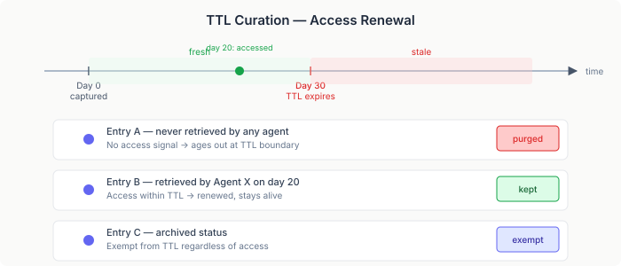

# The Corpus That Grows Itself

Every research session involves web searches. An agent fetches a documentation page, reads an API reference, follows a link to a paper. That knowledge informs the session's work and then evaporates. The next agent investigating the same topic re-fetches the same pages, re-processes the same content, re-discovers the same things.

The waste compounds in a multi-agent system. Five agents researching overlapping topics each make independent HTTP requests to the same URLs, each parse the same HTML, each produce ephemeral results that die with the session. The knowledge exists — it just never persists.

## Corpus-first fetch

The fix is a single tool: `webCapture(url)`. An agent calls it instead of raw web fetch. The tool checks the corpus first — if a previous agent already captured this URL and the content is still fresh, return the cached version. No network, no parsing, no compute. Cache miss triggers the full pipeline: fetch, parse, store, index.

The key insight is where the cache lives. A browser cache is per-user, per-machine. A corpus cache is shared across every agent, every session, every runtime. A page that one agent fetched last Tuesday is instantly available to a different agent running today. The corpus is the cache.


URL dedup is the gatekeeper. Every web-cache entry carries a `fetched_at` timestamp and a `ttl_days` value. Before storing anything, the service queries the corpus by URL using SQLite's `json_extract` on the metadata blob. If a fresh entry exists, the caller gets back the cached content immediately. If the entry exists but has expired, a new version is created and linked to the old one via an `updates` relationship — the versioned chain preserves history without polluting search results.

## The parser that didn't need writing

The first implementation of the HTML parser was hand-rolled. Jsoup for DOM parsing, a content-density scoring algorithm inspired by Mozilla's Readability.js for article extraction, and a tree walker that converted HTML elements to positional markdown one tag at a time. Headings, lists, tables, blockquotes, code blocks, images, links, inline formatting — all implemented from scratch. It worked. It was 314 lines.

It was also reinventing two well-solved problems.

Readability4J is a JVM port of Mozilla's Readability.js — the same algorithm that powers Firefox Reader View. It handles the messy reality of web pages: navigation bars, ad blocks, cookie banners, sidebars, footers. It has been tested against millions of web pages over years. My content-density scorer was a naive approximation of what that project refined through sustained, real-world iteration.

Flexmark's HTML-to-markdown converter handles the structural conversion: headings, nested lists, table alignment, inline formatting, code blocks. It handles edge cases I hadn't thought about yet and wouldn't have found until production traffic hit them.

The rewrite replaced 314 lines with 131. But the line count isn't the point. The custom code that remained is the integration layer — the part that is genuinely specific to this system. Setext-to-ATX heading conversion (flexmark defaults to `===` underlines; the structural chunker needs `#` prefixes). Positional markdown annotations (`#@ page:`, `#@ table:`, `#@ figure:`) injected by scanning the converted output. Metadata extraction combining Readability4J's article metadata with Jsoup fallbacks for meta tags. Boilerplate cleanup as a safety net after Readability4J's extraction.

That's the correct distribution of effort. Established libraries handle the general problem. Custom code handles the system-specific integration. The ratio should be heavily weighted toward the former.

## SPI decoupling

The parser module carries heavy dependencies — Tika, PDFBox, POI for PDF and DOCX parsing, plus Readability4J, Flexmark, and Jsoup for HTML. The corpus management module — where the MCP tool lives — should not transitively depend on any of them.

The solution is a one-method SPI:

```java
@FunctionalInterface
public interface HtmlToMarkdownParser {
    String parse(String html, String sourceUrl);
}
```

The SPI lives in `corpus-management-api`. The implementation lives in `corpus-management-parsers`. When the parsers module is on the classpath, it provides the implementation. When it isn't, the MCP tool stores HTML as-is. No compile-time coupling, no transitive dependency chains, no classpath pollution.

This is the same CDI `Instance<T>` pattern used throughout the platform — optional capabilities that activate by classpath presence rather than configuration. The corpus management module never imports a class from the parsers module. It asks the CDI container for an `HtmlToMarkdownParser` and gracefully handles absence.

## Access as curation

A web cache that captures every page an agent visits accumulates noise. Most fetched pages are glanced at once and never consulted again. Without curation, the cache degrades search quality — more entries means more irrelevant results competing for attention.

The curation signal is already being collected. The retrieval tracker — built for RAG quality measurement — records every time any agent retrieves any document from the corpus. That access data is exactly the curation signal a cache needs.



Every web-cache entry has a TTL — thirty days by default. The curation service scans web-cache entries and checks whether any agent retrieved them within their TTL window. If so, the entry is renewed — the access proves its continued usefulness. If no agent has touched it since capture, and the TTL has passed, the entry is evicted.

The multi-agent property is what makes this work. A page that five independent agents in separate sessions all find useful is clearly worth keeping. One agent's search patterns might be idiosyncratic; five agents' overlapping retrievals are a strong quality signal. Archived entries are exempt — explicit curation decisions override automatic eviction.

No scheduled curation review. No LLM judgment calls. The cache works like a browser cache scaled across agents — content that earns its place stays; content that doesn't, doesn't.

## What grows from this

A knowledge system that accumulates from use changes what's possible for multi-agent research. Each session's web research becomes available to every future session. Topics that multiple agents investigate build rich, deduplicated coverage over time. The corpus doesn't just store what someone put in it — it grows from the collective activity of every agent that uses it.

The practical architecture is five components: an HTML parser built on established extraction libraries, a store with URL dedup and TTL-aware versioning, an MCP tool that makes the cache invisible to the agent, optional PDF archiving for visual fidelity, and access-renewal curation that keeps the useful and evicts the noise.

An agent that calls `webCapture(url)` doesn't know or care whether the content comes from the network or the corpus. That's the point. The cache is an implementation detail. The knowledge persistence is the feature.
