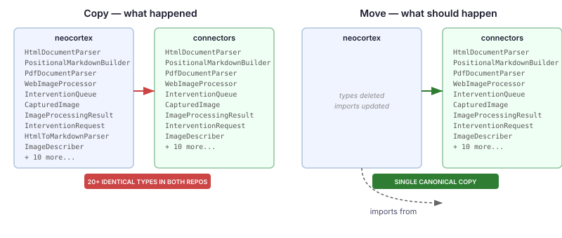
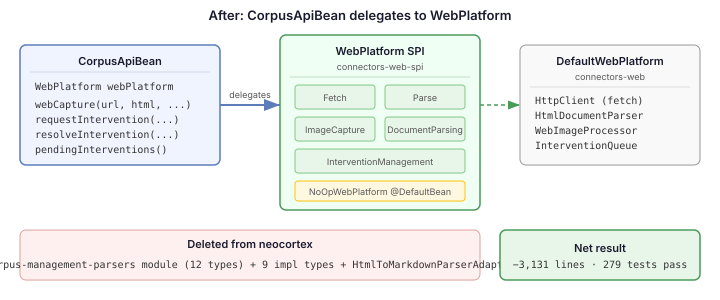

# The Move That Wasn't

Yesterday I described how the web capture pipeline — fetch, parse, image extraction, intervention inbox — was extracted from neocortex to the connectors WebPlatform SPI. Twenty-seven source files, eleven test files, a clean separation of concerns. The pipeline was no longer a corpus feature; it was a general web content acquisition capability that any application could use.

Except the extraction never happened. The files were copied, not moved.

## Twenty duplicate types hiding in plain sight

The neocortex repo still had every original file. The corpus-management-parsers module — twelve parser types, six SPI interfaces, eight test files — was byte-identical to the connectors web module. `HtmlDocumentParser`, `PositionalMarkdownBuilder`, `PdfDocumentParser`, `DocxDocumentParser`, `ImageDocumentParser`, `LayoutPresets` — every one of them existed in both repos with the same logic, the same method signatures, the same tests. Only the package declarations differed.

On top of that, `CorpusApiBean` still constructed its own `HttpClient` for fetching, took `HtmlToMarkdownParser` and `WebImageProcessor` as constructor parameters, and managed its own `InterventionQueue`. Nine more types duplicated between the impl package and connectors: `CapturedImage`, `ImageProcessingResult`, `InterventionRequest`, `InterventionResult`, `InterventionQueue`, `WebImageProcessor`, `HtmlToMarkdownParser`, `ImageDescriber`, `HtmlToMarkdownParserAdapter`.

Nothing failed. Both repos compiled independently. Tests passed in both places. The duplication was invisible because each repo resolved its own copy. There was no compilation error, no test failure, no warning. The only way to discover it was to open both repos and compare, file by file.

## Why copy fails and move doesn't

The root cause is mechanical. When code moves between repos, three things need to happen atomically: the file appears in the target, the file disappears from the source, and all import statements across both repos update. A copy does only the first. The source keeps its original, consumers in the source repo keep binding to the local copy, and there's no signal that anything is wrong.

IntelliJ's refactor-move does all three in one operation. Open both repos in a single workspace, move the file, and the IDE deletes the source, creates the target, and rewrites every import across both projects. If any consumer in the source repo still references the old location, the build breaks immediately — the gap is visible before the commit.

This isn't about IDE preference. It's about atomicity. Any tool that guarantees all three steps happen together prevents the failure mode. Any process that separates them — copy now, clean up later — relies on someone remembering to finish. In a codebase with dozens of modules and transitive dependencies, "clean up later" means "never."

## Completing the migration

The fix was straightforward once the scope was understood. Delete the entire `corpus-management-parsers` module — all twelve duplicated types gone in one directory removal. Relocate the two neocortex-specific types (`DefaultStructuralChunker` and `DocumentCorpusTypes`) to the corpus-management module where they belong. Wire `CorpusApiBean` to inject `WebPlatform` instead of managing its own parallel stack.

The constructor that took three specific collaborators — `HtmlToMarkdownParser`, `WebImageProcessor`, `InterventionQueue` — now takes one: `WebPlatform`. The `webCapture()` method delegates to `WebPlatform.Fetch`, `WebPlatform.Parse`, and `WebPlatform.ImageCapture` through capability checks. The intervention methods delegate to `WebPlatform.InterventionManagement`. When no `WebPlatform` is configured, the `NoOpWebPlatform` `@DefaultBean` provides graceful degradation — the same CDI pattern used throughout the platform.

The `InterventionManagement` SPI needed widening first. The original interface's `request()` method returned only a String ID and didn't accept `screenshotRef`. Its `resolve()` returned void and took an unused `html` parameter. Both were too narrow for what `CorpusApiBean` needed. The widened versions return the full `InterventionRequest` record, accept `screenshotRef`, and drop the dead parameter.

## What the audit found

Claude ran a three-fork audit after the refactoring: migration completeness, correctness, and test coverage. The migration audit confirmed all duplicates were gone except three layout types (`PanelDefinition`, `LayoutClassification`, `LayoutClassifier`) that need a separate dependency-direction decision. The correctness audit found three robustness gaps: fetch failures with status code zero were silently storing empty content, image capture exceptions could abort the entire pipeline, and `FetchResult.html()` could return null without a guard. The test coverage audit found six missing edge-case tests — null WebPlatform paths, the fetch delegation path, `screenshotRef` round-trips.

All three sets of findings were fixed in the same session. The final test count went from 263 to 279 — not because we needed more tests, but because the audit exposed paths that the original code never tested either.

## The broader lesson

Migration discipline is a specific instance of a general problem: operations that succeed partially look like operations that succeeded completely. A file copy that doesn't delete the source is indistinguishable from a successful move until someone compares both sides. A database migration that creates new columns but doesn't drop the old ones looks clean until someone queries the old column and gets stale data.

The defence is the same in every case: make the operation atomic, or make the incomplete state visible. IntelliJ's refactor-move is atomic — it can't leave the source behind. A migration script that deletes-then-creates in a transaction makes incomplete state impossible. A CI check that flags duplicate type names across repos would have caught this the day it happened.

The neocortex codebase is three thousand lines lighter. The connectors repo is the single owner of web content acquisition. And the next time code needs to move between repos, the tool that does all three steps in one operation is the only tool worth reaching for.
